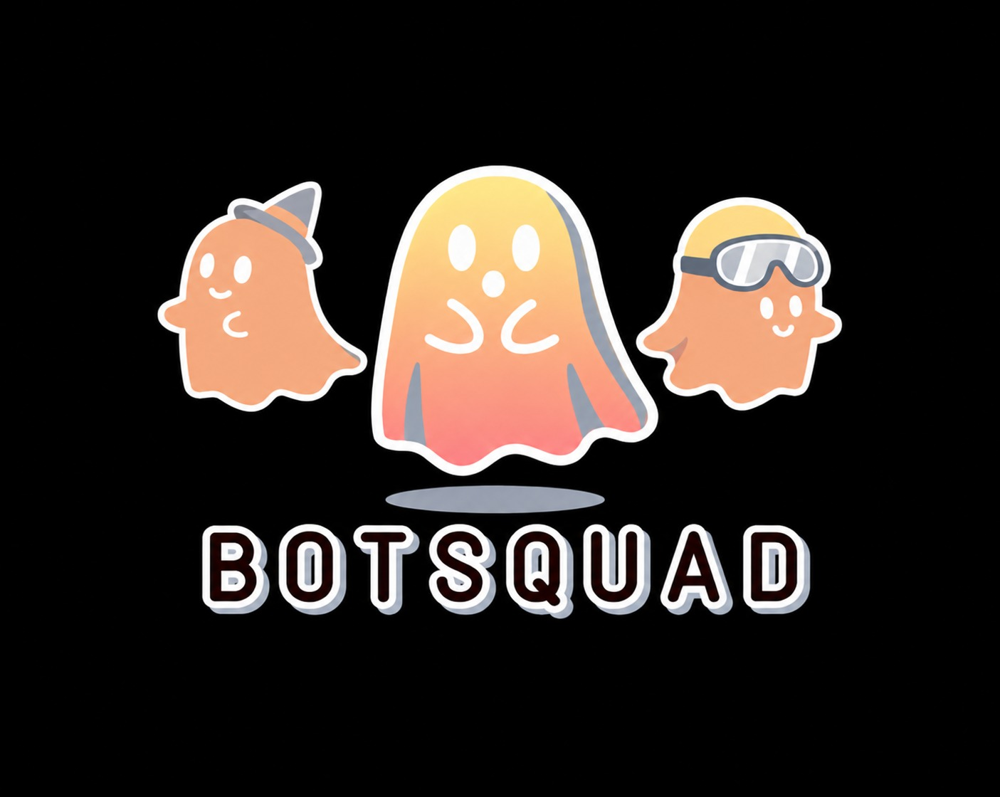

<div align="center">



# BotSquad

**Your team of AI bots, in your pocket.**

[](https://github.com/sarfaraj78653738-star/BotSquad/actions)


</div>

Clean-room, original code and copy. No affiliation with any other AI product.

BotSquad is a local-first Android app. You build a team of bots, each with
its own role, personality, provider, and model — then chat with them
one-on-one or together in a group. Your chats stay on your device, your
API keys stay in the device secure store, and they are sent only to the
provider you chose. No server of ours sits in the middle.

## Features

| Feature | What it does |
|---|---|
| Bot team | Create, edit, and delete bots. Each bot has a name, role, task, personality, instructions, boundaries, provider, and model. |
| Group chat | Pick 2+ bots, send one message, and each bot replies in turn in its own words, followed by a summary. |
| Agent Mode | Bots can work in a phone-local workspace: read and write files, preview HTML, and deploy — every file change and deploy pauses for your approval. |
| 58 connections | Connect services (AI providers, GitHub, Vercel, and more) with per-service fields and live verification. Bots see only verified connections, never your keys. |
| Skills & plugins | Install skills, plugins, and MCP servers from GitHub. Skills run as chat instructions via `/name` callouts; plugin code runs in a hidden on-phone sandbox. |
| BYOK | Bring your own keys for OpenAI-compatible, Anthropic, and Gemini providers. No key means a clear "add your key" message — never a fake reply. |
| Local-first & private | Chats and workspace live in on-device SQLite. Keys live in SecureStore. Nothing is sent anywhere except to the provider you picked. |
| Google sign-in | Native sign-in on first launch. After that the app opens straight to Main Chat. Settings has Log out and Delete account (which wipes all local data). |
| Premium | Free version shows ads during reply loading. Premium removes ads — and only that. Payments are webhook-verified before anything is granted. |

## Download

No Play Store release yet. Grab the latest release APK from CI:

1. Open [Actions](https://github.com/sarfaraj78653738-star/BotSquad/actions) and pick the latest green **Build Android APK** run.
2. Download the `botsquad-release-apk` artifact and unzip it.
3. Install the APK on your Android phone (allow "install unknown apps" for your browser/files app when asked).

Release builds are signed with a stable release key, so updates install over the old version without uninstalling.

## Build from source

```bash
bun install
npx tsc --noEmit
CI=1 npx expo prebuild --platform android
cd android && ./gradlew assembleRelease
# APK at: android/app/build/outputs/apk/release/app-release.apk
```

Release signing uses four repo secrets (`RELEASE_KEYSTORE_BASE64`,
`RELEASE_KEYSTORE_PASSWORD`, `RELEASE_KEY_ALIAS`,
`RELEASE_KEY_PASSWORD`). Without them the build falls back to the debug
keystore. A debug build needs no signing at all:
`./gradlew assembleDebug`.

## Project structure

- `app/` — Expo Router screens: login, chats, bots, groups, workspace, settings, and more.
- `src/lib/` — The app's brains: providers, database (SQLite), keys (SecureStore), agent tools, connections, MCP, GitHub install, premium.
- `src/components/` — Shared UI primitives and the animated bot avatar.
- `server/razorpay-worker/` — The Cloudflare Worker that verifies Razorpay webhooks before premium is granted.
- `.github/workflows/` — CI: typecheck, prebuild, and a signed release APK on every push to main.

## Contributing

Issues and pull requests are welcome. If you find a bug, a screenshot
or screen recording helps more than a long description.
